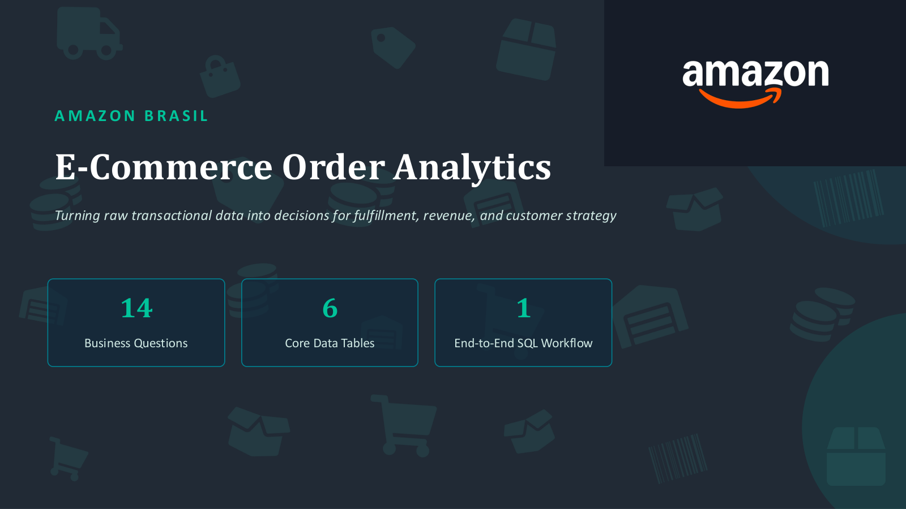

<h1 align="center">Amazon Brazil — SQL Analysis</h1>

<p align="center">
  
  
  
  
  
  
</p>

<p align="center">
  
</p>

## Overview

A 14-question SQL case study on Amazon Brazil's internal order database, covering customers, sellers, products, orders, payments and reviews. Amazon Brazil is scaling fast in Latin America's largest e-commerce market, and its operations and strategy team needs to know which customers drive revenue, which sellers deliver, which categories are growing and where fulfillment breaks down. Each question is tied to a real stakeholder decision, from fulfillment-centre investment to a "Top Seller" badge programme.

The project moves from basic aggregation up through joins, anti-joins, subqueries, window functions and a median calculation. A companion PPT/PDF in this repo walks through every question with its query and output side by side.

## The Dataset

An order database with these entity groups:

| Table group | Description |
|---|---|
| Customers | Who orders, including the state they live in |
| Sellers | Registered sellers and their state |
| Products | Catalogue items and their categories |
| Orders | Order timeline, status and delivery dates |
| Payments | Payment type and value per order |
| Reviews | Review scores left by customers |

*Table and column names are in `amazon_data_dictionary.txt`, which is not included here.*

## The Questions

Each question is followed by the business decision it supports.

<details>
<summary><b>Easy (4)</b></summary>

1. **Orders fulfilled by each seller state** — *where to invest in regional fulfillment centres.*
5. **Average review score for each product category** — *which categories need intervention first.*
8. **Top 5 product categories by total revenue** — *which categories get homepage space before big sales events.*
14. **Month with the highest number of orders** — *warehouse capacity, staffing and campaign timing for the peak season.*

</details>

<details>
<summary><b>Medium (7)</b></summary>

3. **Most-used payment method and average order value per payment type** — *input for payment-provider contract talks.*
4. **Customer who has spent the most** — *who to onboard first into a premium loyalty tier.*
6. **Total orders by each customer, broken down by customer state** — *state-level acquisition and loyalty campaigns.*
7. **Sellers who registered but never fulfilled an order** — *the dormant-seller re-engagement list.*
10. **Products that have never been ordered** — *dead listings to review, reprice or remove.*
12. **States with the highest average review score for orders delivered there** — *where last-mile delivery needs to improve.*
13. **Customers who placed orders but never left a review** — *the target list for review reminders.*

</details>

<details>
<summary><b>Hard (3)</b></summary>

2. **Cumulative revenue per category as orders come in over time** — *when categories hit revenue targets, for planning flash sales.*
9. **Median delivery time in days, from order placement to delivery** — *the true typical wait, since a few extreme delays skew the average.*
11. **Sellers who fulfilled more orders than the average seller** — *the invite list for the "Top Seller" badge.*

</details>

*Question numbers match the original brief. The Easy / Medium / Hard split is my own grouping by the SQL concepts each question needs.*

## Techniques Used

`JOIN` / `LEFT JOIN` (anti-join with `IS NULL`) · `GROUP BY` & `HAVING` · Aggregate functions (`SUM`, `AVG`, `COUNT`) · Subqueries · Window functions (running total, median) · Date functions · `ORDER BY` / `LIMIT` ranking

*Trim this to the techniques your queries actually use.*

## Repository Structure

```
amazon-brazil-sql-analysis
├── amazon_queries.sql             ← All SQL queries (add your file here)
├── Amazon_Brazil_SQL.pdf          ← Query + output walkthrough (add your file here)
├── cover.png                      ← Repo cover image
└── README.md
```

---

## About Me

**Anmol Agarwal**
Business Analyst

[](https://www.linkedin.com/in/anmol-agarwal123/)
[](https://github.com/Anmolagarwal19)
[](mailto:agarwalanmol799@gmail.com)

*If this project was useful, a star on the repo is appreciated — feel free to reach out for feedback, questions, or opportunities.*
